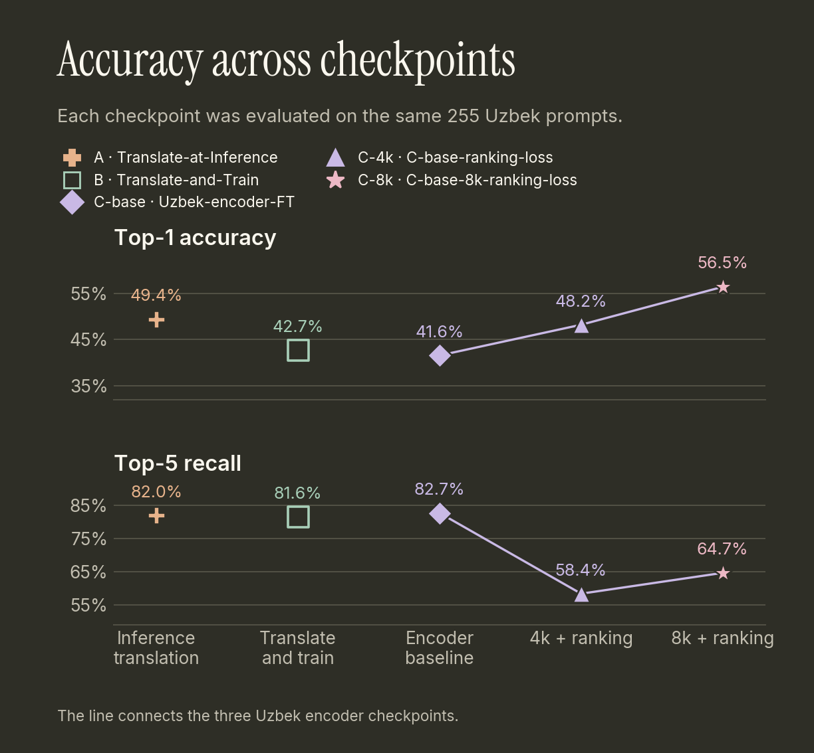
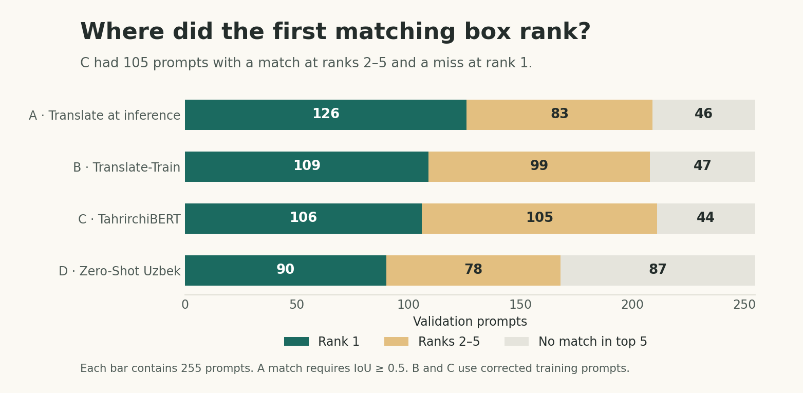
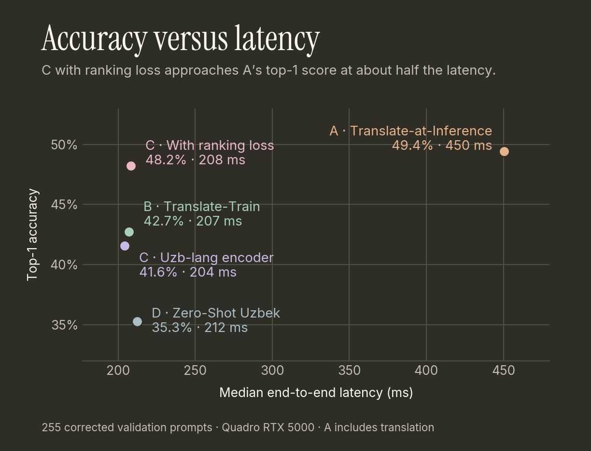
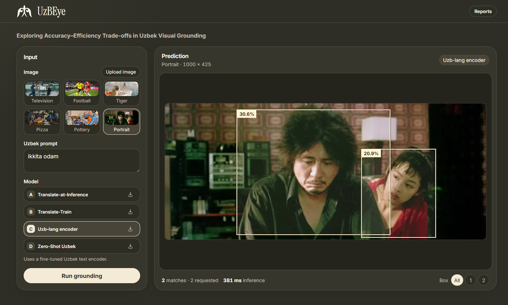

# UzBEye: Exploring Accuracy–Efficiency Trade-offs in Uzbek Visual Grounding


UzBEye is an applied experiment in **Uzbek visual grounding**. Given an image and a phrase such as *chapdagi ko‘k soyabon* (“the blue umbrella on the left”), the system ranks boxes that could match the phrase. The best direct-Uzbek run reached **56.5% top-1 accuracy at 236 ms median latency** on a fixed 255-prompt validation set. The uncached translation baseline reached **49.4% at 450 ms**.

## Motivation

Grounding DINO uses a text prompt to locate an object or region. To use an English-oriented checkpoint with Uzbek prompts, one can translate the query first or adapt the detector to Uzbek text. Translation adds work to every uncached query and can change cues such as position, color, or count. Direct grounding moves that work into fine-tuning and requires the model to learn which Uzbek words distinguish the target from nearby objects. [Grounding DINO paper](https://arxiv.org/abs/2303.05499)

The study asks two questions. How does direct Uzbek grounding compare with translation at inference time on accuracy and latency? Can a training objective that explicitly ranks a matching box above its strongest competitor improve the first prediction while preserving useful alternatives? C-base motivated the second question. It returned the correct box at ranks 2–5 on **105 of 255 prompts** where its first prediction missed.

| Model | Approach |
|---|---|
| A · Translate-at-Inference | Translate Uzbek to English with NLLB, then run pretrained Grounding DINO-Tiny. |
| B · Translate-and-Train | Keep the original text encoder and fine-tune on corrected Uzbek RefCOCOg prompts. |
| C-base · Uzbek-encoder-FT | Replace the detector’s text encoder with TahrirchiBERT and fine-tune on corrected 4k Uzbek prompts. |
| C-4k · C-base-ranking-loss | Use the C-base architecture and the corrected 4k prompts with ranking loss. |
| C-8k · C-base-8k-ranking-loss | Use the C-base architecture with ranking loss on the polished 8k dataset. |

## Methodology

### Dataset and translation audit

The 4k dataset uses **4,085 training expressions over 3,763 images** from the RefCOCOg UMD split. Each row pairs an expression with a target box on a COCO image. The initial audit revised 3,328 of 4,340 training and validation prompts while preserving source expression IDs, images, boxes, and splits. The fixed evaluation set contains **255 corrected Uzbek expressions**. [RefCOCOg split and API](https://github.com/lichengunc/refer#how-to-use)

The larger set contains **8,000 training expressions over 7,090 images** and preserves those same validation rows. The expansion adds contrastive examples where two targets of the same category appear in a scene. The subsequent wording audit compared English cues against the annotated regions and revised 313 training expressions in the expanded set. The local audit stores the original and revised text by expression ID. See [dataset preparation](#expanded-8k-training-set).

### Training design

Model C freezes the vision backbone and box heads. Fine-tuning updates the text projection, the final text encoder block, the last visual–text fusion layer, and the last decoder layer’s text cross-attention. This trains **9.13M of 172.25M parameters**. The three main C runs use seed 42, AdamW with an initial learning rate of $5 \times 10^{-5}$, cosine decay, mixed precision, and eight accumulated examples per optimizer update. The trainer saves the earliest checkpoint at the highest validation top-1 accuracy. [Trainable modules](src/models/adapters.py) · [Trainer](src/training/trainer.py)

| Model C run | Training examples | Ranking term | Best / completed epoch | Total optimizer updates |
|---|---:|---|---:|---:|
| C-base | 4,085 | Off | 1 / 3 | 1,533 |
| C-4k | 4,085 | On | 4 / 5 | 2,555 |
| C-8k | 8,000 | On | 4 / 5 | 5,000 |

### Ranking objective

For candidate box $b_i$ and prompt token logits $z_{it}$, the box score is the mean sigmoid over the $T$ tokens belonging to the referring expression.

```math
s_i = \frac{1}{T}\sum_{t=1}^{T}\sigma(z_{it})
```

Let $`b^*`$ be the labeled box and $`q_i = \operatorname{IoU}(b_i,b^*)`$. The positive $i^+$ is the candidate with maximum IoU. The negative $i^-$ is the highest-scoring candidate with $`q_i < 0.5`$. When $q_{i^+}\ge 0.5$ and a negative exists, the ranking term is

```math
\mathcal{L}_{\mathrm{rank}} =
\max\left(0,\; 0.10 + s_{i^-} - s_{i^+}\right).
```

The term is zero when either candidate is unavailable. It penalizes score gaps smaller than 0.10 on the same score scale used at inference. The overlap selects the pair during training. Inference ranks candidates by $s_i$ from the detector's usual forward pass. [Loss implementation](src/training/trainer.py#L16) · [Inference scoring](src/models/grounding_dino.py#L49)

With ranking enabled, the full loss is

```math
\begin{aligned}
\mathcal{L} &= \mathcal{L}_{\mathrm{focal}} + 5\lVert b_j-b^*\rVert_1 \\
&\quad + 2\bigl(1-\operatorname{GIoU}(b_j,b^*)\bigr)
+ \mathcal{L}_{\mathrm{rank}}.
\end{aligned}
```

Here $j$ is the query matched by the base objective, using a cost that weights normalized center-and-size distance by 5, generalized IoU by −2, and the box score by −1. The ranking positive is selected separately by overlap. The focal term uses $\alpha=0.25$ and $\gamma=2$. [Focal Loss paper](https://arxiv.org/abs/1708.02002) · [Generalized IoU paper](https://arxiv.org/abs/1902.09630)

### Evaluation protocol

All reported checkpoints were evaluated on the same 255 prompts, each with one labeled target box. **Top-1 accuracy** counts a match if the first candidate has IoU ≥ 0.5. **Top-5 recall** applies the same rule to any of the five highest-scoring candidates. This measures ranked single-target grounding. The demo’s multi-object mode applies separate filtering.

Latency was measured one prompt at a time on a Quadro RTX 5000 after three warm-up queries. The end-to-end measurement includes local image decoding and prediction, plus uncached NLLB translation for A. The benchmark records the evaluation IDs, manifest hash, and checkpoint paths. [Benchmark protocol and results](docs/validation-results.json) · [Benchmark code](src/evaluation/benchmark.py)

## Results

| Model and training data | Top-1 accuracy | Top-5 recall | Median latency |
|---|---:|---:|---:|
| A · Translate-at-Inference | 49.4% (126/255) | 82.0% | 450 ms |
| B · Translate-and-Train | 42.7% (109/255) | 81.6% | 207 ms |
| C-base · Uzbek-encoder-FT | 41.6% (106/255) | **82.7%** | 204 ms |
| C-4k · C-base-ranking-loss | 48.2% (123/255) | 58.4% | 208 ms |
| C-8k · C-base-8k-ranking-loss | **56.5% (144/255)** | 64.7% | 236 ms |

### First prediction and candidate coverage



On the corrected 4k training set, C-4k returned **17 more first-box matches** and **62 fewer top-five matches** than C-base. The drop in top-five recall matters for an interface that offers alternative boxes. The loss compares one positive with one high-scoring negative. A per-image error analysis would help explain the change in candidate coverage.



With the ranking objective retained, C-8k added **21 first-box matches** and **16 top-five matches** over C-4k. Its top-five recall of 64.7% remained below C-base’s 82.7%. The 8k follow-up changed corpus size, translation wording, and the number of optimizer updates together.

### Accuracy and latency



C-8k returned **18 more first-box matches** than uncached translation in this benchmark, with **about 48% lower median query latency**. It also took more work to train. The logged training run lasted about **4.32 hours**, compared with **2.26 hours** for the 4k ranking run. These values separate the upfront training cost from the per-query latency.

To regenerate the figures from the recorded metrics, run `.\.venv\Scripts\python.exe -m scripts.plot_validation_results` after installing the Python and frontend dependencies.

## Conclusion

C-8k is the strongest Model C choice for showing a single box on this validation set. C-base retained more usable suggestions when the interface shows five boxes. The ranking experiment therefore gives different answers depending on how the predictions are used.

The runs use one seed and select checkpoints on the same validation split used for reporting. Early stopping also produced different update counts in the 4k comparison. A controlled follow-up would cross the loss choice with dataset size, match optimizer updates, and repeat over several seeds. An unpolished 8k run on the same expression IDs would isolate the effect of caption edits. The reserved 128 RefCOCOg test expressions currently need Uzbek review for that evaluation.

## Platform



The Vue demo lets users upload an image, switch between the four approaches, and inspect ranked candidate boxes. On the Portrait sample, the prompt *ikkita odam* (“two people”) can display a box for each person.

## Run locally

From the project folder, start the backend. The Uzbek encoder option loads `runs/polished-8k-ranking/C` when available, with `runs/corrected/C` as a fallback. Model B loads from `runs/corrected/B`.

```powershell
.\scripts\serve.ps1
```

The backend also serves the built frontend at [127.0.0.1:8000](http://127.0.0.1:8000). For live Vue development, leave the backend running and open a second terminal in the same project folder.

```powershell
npm --prefix frontend run dev
```

Open [127.0.0.1:5173](http://127.0.0.1:5173). Vite forwards API requests to port 8000. Set `GROUNDING_CHECKPOINTS` before starting the backend to use a different run folder.

For a fresh Windows setup, use Python 3.11, Node.js 24, and an NVIDIA driver compatible with CUDA 11.8.

```powershell
py -3.11 -m venv .venv
.\.venv\Scripts\python.exe -m pip install torch==2.7.1 torchvision==0.22.1 --index-url https://download.pytorch.org/whl/cu118
.\.venv\Scripts\python.exe -m pip install -r requirements.txt
npm --prefix frontend ci
npm --prefix frontend run build
```

Try *ikki odam*, *barcha odamlar*, or *odamlar* for multiple matches. The demo filters overlapping duplicate boxes and displays up to ten matches together. A requested count caps the number of displayed boxes. Single-object expressions retain the ranked view.

Use the download icon in a model row to save its weights. A and D share the Grounding DINO-Tiny file. B and C download the adapter checkpoints selected by the backend. The adapter files require the pretrained detector. C also uses TahrirchiBERT, and A uses NLLB at inference time.

## Reproduce or extend

The commands below use the local corrected manifest. A fresh clone contains source and sample images. Prepare the dataset first, then provide a corrected manifest or use the generated `training_bilingual.json` for a run on the original translations. Each run saves its best validation checkpoint and training log. Set `GROUNDING_CHECKPOINTS` to serve checkpoints from a specific run folder.

```powershell
.\scripts\finetune.ps1 -Model B -RunName reproduction -Manifest data/refcocog/training_bilingual_corrected.json
.\scripts\finetune.ps1 -Model C -RunName reproduction -Manifest data/refcocog/training_bilingual_corrected.json
.\.venv\Scripts\python.exe -m scripts.run_comparison --root data/refcocog --manifest data/refcocog/training_bilingual_corrected.json --runs runs/reproduction --out runs/reproduction-validation --validation
```

To test Model C with the existing loss plus a box ranking loss, use the same corrected manifest and a fresh run name.

```powershell
.\scripts\finetune.ps1 -Model C -RunName corrected-ranking -Manifest data/refcocog/training_bilingual_corrected.json -RankingLoss
```

The launcher starts from the same pretrained weights as the reproduction run. Each validation pass prints top-1 and top-5 at IoU ≥ 0.5. The best checkpoint is selected by top-1, and its paired top-5 is recorded in `runs/corrected-ranking/C/training.json`.

### Expanded 8k training set

The expanded manifest keeps the 4,085 corrected training prompts and adds 3,915 RefCOCOg expressions. All 255 validation rows are identical to the 4k benchmark. The 8,000 training prompts span 7,090 distinct images, including 3,327 new images. In 588 scenes, the additions give the model distinct targets of the same category.

```powershell
.\scripts\finetune.ps1 -Model C -RunName corrected-8k -Manifest data/refcocog/training_bilingual_8k.json
.\scripts\finetune.ps1 -Model C -RunName corrected-8k-ranking -Manifest data/refcocog/training_bilingual_8k.json -RankingLoss
```

The expansion compares two Uzbek translations per English source. It uses two English round-trip checks, tests for identifying cues such as position, color, and count, and directly checks a subset of difficult examples against their English sources. The local `data/refcocog/expansion_8k/` directory holds the candidate translations, direct corrections, selection decisions, and dataset summary. Benchmarks based on this manifest report inference latency. Preprocessing cost and cost totals that depend on it require measured per-prompt translation timings.

To rebuild from the prepared 4k workspace, run `python -m scripts.expand_dataset` with `--stage candidates`, `--stage audit`, and `--stage finalize` in that order. Finalization downloads the selected COCO images and verifies split isolation, prompt length for both tokenizers, and image dimensions and decoding.

### Review Uzbek captions against the images

`scripts.polish_dataset` compares each English prompt and existing Uzbek caption with the annotated image. It saves decisions as it works, so the first command can be rerun after an interruption. Finalization checks rewritten captions by back-translation, preserves the source and box metadata, and writes the separate image-reviewed manifest. It saves bilingual decisions under `data/refcocog/polish_8k/`.

Install and start Ollama, then pull the local review model before running the first two commands.

```powershell
ollama pull qwen3-vl:4b-instruct
.\.venv\Scripts\python.exe -m scripts.polish_dataset --stage review
.\.venv\Scripts\python.exe -m scripts.polish_dataset --stage finalize
.\scripts\finetune.ps1 -Model C -RunName polished-8k-ranking -Manifest data/refcocog/training_bilingual_8k_polished.json -RankingLoss
```

The image-reviewed manifest keeps the 255 previously reviewed validation rows byte-for-byte so the new run can be compared with the earlier validation scores.

To prepare the original subset from scratch, run `scripts.prepare_dataset` with `--root data/refcocog --limits 4096 256 128`, then `src.data.translate` with `--root data/refcocog --stage training --batch-size 16` using `python -m`. Increase the limits to select more expressions. The corrected manifest and its audit are stored separately from this generated baseline.

The Vue app lives in `frontend/`. The API, data pipeline, models, and evaluation live in `src/`, with launchers in `scripts/` and settings in `configs/`. Data, model caches, and run outputs are local artifacts covered by `.gitignore`.

## Credits

[Grounding DINO-Tiny](https://huggingface.co/IDEA-Research/grounding-dino-tiny) · [TahrirchiBERT-base](https://huggingface.co/tahrirchi/tahrirchi-bert-base) · [NLLB-200 distilled 600M](https://huggingface.co/facebook/nllb-200-distilled-600M) · [Sample image credits](frontend/SAMPLES.md). The NLLB model card lists a noncommercial license.

## License

The UzBEye source code is available under the [MIT License](LICENSE). Third-party models, datasets, and demo images are subject to their respective terms.
